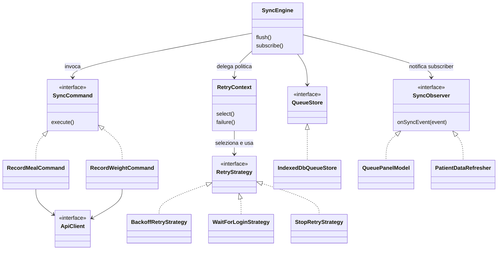
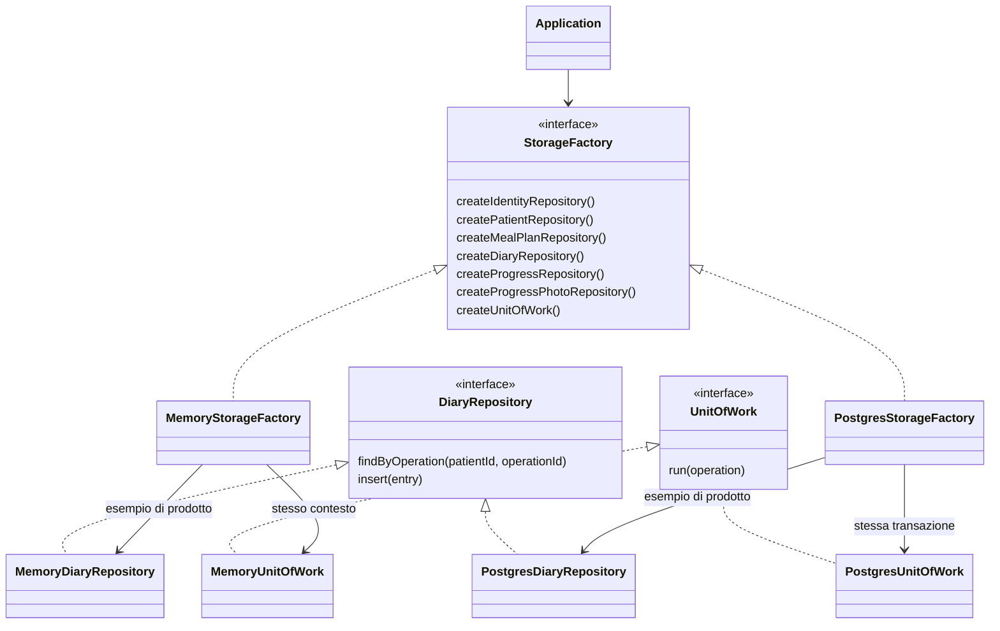

# Pattern del catalogo Refactoring Guru e architettura di NutriTrack
Aggiornamento: 4 novembre 2026, refactoring autorizzato. La prima classificazione del codice precedente riconosceva Adapter e Facade. Dopo la separazione della sincronizzazione e della creazione dello storage sono documentati **sei pattern GoF**: Adapter, Facade, Command, Strategy, Observer e Abstract Factory. Le prove del refactoring sono riportate separatamente dalle evidenze storiche del 30 ottobre.

Il [catalogo Refactoring Guru](https://refactoring.guru/design-patterns/catalog) comprende 22 pattern GoF (Gang of Four), raggruppati in creazionali, strutturali e comportamentali. Repository, Unit of Work e modular monolith sono importanti, ma appartengono ad altre categorie. Le corrispondenze qui sotto sono letture motivate di ruoli e collaborazioni effettive, non conteggi basati sui nomi delle classi.

## 1. Che cosa cambia e che cosa resta uguale
| Area | Prima del refactoring | Dopo | Vantaggio concreto |
|---|---|---|---|
| Invio della coda | flushQueue sceglieva endpoint e invio dentro il ciclo | SyncCommand con execute(), RecordMealCommand e RecordWeightCommand | Il ciclo gestisce il ciclo di vita, il comando sa come inviare la propria operazione |
| Gestione errori | Una funzione con classificazione e calcolo di retry | RetryStrategy e tre algoritmi espliciti | Politica verificabile e sostituibile senza modificare il motore |
| Aggiornamento UI | Un booleano changed obbligava il chiamante a decidere tutto | SyncEngine pubblica eventi a observer registrati | Pannello coda e refresh dati reagiscono indipendentemente |
| Costruzione storage | repository(key, initial) e costruzione manuale nella composition | StorageFactory con prodotti tipizzati per ciascun modulo e UnitOfWork coerente | Application non sceglie chiavi di storage né mischia famiglie memory/PostgreSQL |

Questo è un refactoring: cambia la struttura interna, non i requisiti. DTO IndexedDB e operationId restano compatibili; il server decide la versione valida al consumo. Non sono stati aggiunti undo, notifiche di prodotto, broker, nuove misurazioni o nuovi ruoli.

## 2. Facade — ingresso semplice al sottosistema
Fonte teorica: [Facade](https://refactoring.guru/design-patterns/facade). Una facciata offre un'operazione pubblica più semplice della collaborazione interna che realizza.

Esempio: [DiaryService.record](../apps/api/src/modules/diary/public/index.ts). Il controller chiede di registrare un pasto senza conoscere la sequenza interna di autorizzazione, validazione, deduplicazione, risoluzione della versione tramite MealPlanning e salvataggio. [MealPlanningService.publish](../apps/api/src/modules/meal-planning/public/index.ts) nasconde invece validazione, confronto baseVersion, pubblicazione temporale, ChangeSet e repository.

I public/index.ts sono gli ingressi dei moduli. Il solo export non costituisce una Facade: la caratteristica rilevante è la semplificazione di un flusso che coinvolge più collaboratori. Le stesse classi sono anche application service; le due letture non si escludono. [offline.ts](../apps/web/src/offline.ts) conserva inoltre funzioni compatibili con i chiamanti precedenti, delegando al nuovo sottosistema sync.

**Beneficio:** il chiamante dipende dall'operazione di business, non dai dettagli. **Costo:** la facciata va mantenuta focalizzata e non trasformata in un servizio universale che possiede tutti i dati.

## 3. Adapter — repository come contratto atteso
Fonte teorica: [Adapter](https://refactoring.guru/design-patterns/adapter). L'adapter traduce un'interfaccia esterna nell'interfaccia richiesta dal client.

| Ruolo | Codice |
|---|---|
| Client | Servizi dei cinque moduli |
| Target | Il contratto di repository di ogni modulo, per esempio `DiaryRepository` |
| Adapter concreti | `MemoryDiaryRepository` e `PostgresDiaryRepository` in [diary-repositories.ts](../apps/api/src/infrastructure/diary-repositories.ts) |
| Adaptee PostgreSQL | Delegate Prisma delle tabelle assegnate al modulo |
| Traduzione | `findByOperation` cerca per paziente e ID dell’operazione. `insert` salva una nuova riga. |

Il servizio chiama il proprio contratto. L’adapter PostgreSQL converte i tipi di Prisma nei tipi del modulo e traduce le operazioni in query. L’adapter in memoria realizza lo stesso contratto sullo stato della Unit of Work di test.

**Beneficio:** stesso contratto per logica applicativa e test. **Costo:** conversioni e confine tecnico da mantenere coerenti. Il termine «adapter HTTP» rimane utile architetturalmente, ma l'adapter repository è il riscontro GoF più preciso.

## 4. Command — operazioni offline eseguibili
Fonte teorica: [Command](https://refactoring.guru/design-patterns/command). Il pattern incapsula una richiesta in un oggetto con un contratto di esecuzione.

Nel vecchio ciclo l'elemento della coda era solo un record serializzabile e il motore decideva endpoint e invio. Ora [commands.ts](../apps/web/src/sync/commands.ts) ricostruisce un SyncCommand dal DTO persistito.

| Ruolo | Realizzazione |
|---|---|
| Command | SyncCommand, con execute() |
| Concrete Command | RecordMealCommand e RecordWeightCommand |
| Invoker | SyncEngine, in [sync-engine.ts](../apps/web/src/sync/sync-engine.ts) |
| Receiver | ApiClient iniettato, che inoltra la richiesta al backend |
| Dati persistiti | Queued in [types.ts](../apps/web/src/sync/types.ts): account, kind, payload e operationId stabile |
| Ripristino | restoreCommand(dto) ricrea il comando adatto dopo lettura IndexedDB |

I metodi delle classi non vengono serializzati in IndexedDB: si conservano i dati e si ricostruisce l'oggetto eseguibile. RecordMealCommand conosce l'invio diario, RecordWeightCommand l'invio peso; il motore continua a controllare account attivo, sessione, tempi e stato della coda. I comandi copiano il payload con structuredClone, proteggendolo sia da modifiche successive del chiamante sia da mutazioni di un receiver durante execute; non cambiano l'identità dell'operazione.

**Beneficio:** il motore non deve incorporare la richiesta concreta; ogni comando è verificabile con un ApiClient fake. **Costo:** classi e ripristino espliciti per due sole operazioni. La separazione è giustificata dall'esistenza di due richieste e della coda persistente, non da una promessa di decine di feature future.

**Vincoli:** operationId e payload non cambiano durante retry. execute non garantisce di per sé idempotenza: la garantiscono anche ricevuta e transazione server. Command non richiede necessariamente undo; qui non viene introdotta cancellazione di pasti o peso. restoreCommand è una funzione di creazione semplice, non una gerarchia Factory Method GoF.

## 5. Strategy — politiche di retry separate dal motore
Fonte teorica: [Strategy](https://refactoring.guru/design-patterns/strategy). Il pattern racchiude algoritmi alternativi dietro lo stesso contratto e permette al contesto di delegare la decisione.

SyncEngine delega la politica a RetryContext, che seleziona una RetryStrategy e ne usa decide(error, attempts, now). [retry.ts](../apps/web/src/sync/retry.ts) contiene questi contratti e tre strategie:
- **BackoffRetryStrategy:** errori temporanei/rete, inclusi 408 e 429, rimangono PENDING; attesa crescente con limite di 60 secondi.
- **WaitForLoginStrategy:** 401 porta ad AUTH_REQUIRED; non insiste con credenziali scadute e attende nuovo login.
- **StopRetryStrategy:** conflitto 409 resta CONFLICT e validazione/altri dinieghi client diventano REJECTED; nessun retry automatico continuo.

### Prima e dopo
Prima failureState classificava l'errore e calcolava l'attesa nello stesso blocco. Il ciclo era legato a quella funzione. Ora RetryContext.failure riceve elemento, errore e istante; select sceglie la strategia, decide restituisce RetryDecision (status, nextAttempt e stopBatch), e il motore applica il risultato tramite QueueStore. RetryContext è una classe di coordinamento, non il DTO degli input. La scelta concreta resta esplicita e non coincide con aggiungere uno stato nuovo.

### Vantaggio introdotto
1. **Responsabilità separata:** invio e progressione del batch appartengono al motore; status, tentativi e attesa appartengono alla politica.
2. **Test indipendenti dal tempo reale:** RetryContext riceve now, quindi il test verifica esattamente nextAttempt senza aspettare davvero.
3. **Sostituibilità locale:** una diversa politica per guasti temporanei può essere fornita senza cambiare RecordMealCommand, RecordWeightCommand, IndexedDB o l'algoritmo di invio.
4. **Casi permanenti leggibili:** autenticazione e conflitto hanno regole distinte; una modifica al backoff non deve accidentalmente far ritentare una validazione.
5. **Collaboratori testabili:** store, client e clock fake permettono di verificare il motore senza rete.

**Le regole restano:** problemi transitori ritentabili, 401 in attesa login, 409 in conflitto e altri errori client permanenti respinti. Per gli stessi input la nuova decisione è deterministica; stopBatch rende esplicito anche quando fermare il batch dopo una sessione scaduta. L'attesa serve alle pending, non a riattivare automaticamente conflitti o validazioni. Non si passa a una politica casuale né a last-write-wins. La Strategy non «risolve» una baseVersion obsoleta, non abilita letture private e non concede autorizzazioni al client: queste regole restano server-side.

**Costi e limiti:** più tipi/classi e una selezione iniziale da comprendere. La selezione può ancora contenere condizioni; il pattern non elimina ogni if. Non contiamo anche lo storage memory/PostgreSQL come Strategy: quello è ora la famiglia Abstract Factory descritta sotto. Una futura aggiunta di politiche resta una modifica tecnica da motivare, non una feature implicitamente autorizzata.

## 6. Observer — reazioni locali alla sincronizzazione
Fonte teorica: [Observer](https://refactoring.guru/design-patterns/observer). Il subject gestisce sottoscrizioni e notifica observer senza decidere come ciascuno aggiorni il proprio stato.

| Ruolo | Realizzazione |
|---|---|
| Subject | SyncEngine |
| Notifica | SyncEvent con account e risultato significativo |
| Observer del pannello | QueuePanelModel |
| Observer dei dati Patient | PatientDataRefresher |
| Wiring e ciclo di vita | Sottoscrizioni reali in [App.tsx](../apps/web/src/App.tsx), con pulizia al cambio account/unmount |

Gli observer sono in [observers.ts](../apps/web/src/sync/observers.ts). Il motore pubblica cambiamenti; il pannello rilegge la coda e il refresher aggiorna i dati solo per l'evento confirmed. flush conserva un booleano changed per compatibilità, ma App non lo usa più per decidere entrambe le reazioni: usa i subscriber.
Gli eventi queued, failed, confirmed e retry-ready vengono emessi dopo il rispettivo salvataggio/rimozione locale. Gli observer leggono quindi lo stato persistito. Un errore in un observer è isolato con Promise.allSettled: non trasforma un comando già confermato in un nuovo fallimento da ritentare.

**Beneficio:** due consumer con responsabilità diverse senza nuove dipendenze dal motore verso React. **Costo:** ciclo di vita delle sottoscrizioni, gestione degli aggiornamenti asincroni e protezione dagli eventi di account precedenti. L'account contenuto nella notifica e la pulizia dei subscriber impediscono che una risposta tardiva aggiorni il nuovo utente.

Questo Observer è locale al browser: non è il bus di eventi di dominio menzionato come possibile evoluzione in ADR-013, non invia notifiche a persone e non introduce consegna durevole. I permessi del Nutritionist si verificano ancora al server. Gli stati PENDING/CONFLICT restano valori, non oggetti State GoF.

### Vista delle collaborazioni offline

Il diagramma mostra responsabilità e nomi, non tutte le firme TypeScript. I dettagli precisi si leggono nei file e nei test.

## 7. Abstract Factory — famiglia coerente di storage
Fonte teorica: [Abstract Factory](https://refactoring.guru/design-patterns/abstract-factory). La factory astratta costruisce una famiglia di prodotti correlati senza esporre al client le classi concrete.

[storage-factory.ts](../apps/api/src/infrastructure/storage-factory.ts) dichiara le operazioni di costruzione dei repository e della Unit of Work:
- createIdentityRepository;
- createPatientRepository;
- createMealPlanRepository;
- createDiaryRepository;
- createProgressRepository;
- createProgressPhotoRepository;
- createUnitOfWork.

Le factory concrete MemoryStorageFactory e PostgresStorageFactory costruiscono i repository dei cinque moduli e la Unit of Work che opera sullo stesso contesto transazionale. `Application` usa il contratto astratto e consegna il prodotto corretto a ogni servizio. [Factory concrete](../apps/api/src/infrastructure/persistence.ts), [composizione](../apps/api/src/composition/application.ts)

### Perché è una famiglia, non solo una funzione new
Un repository PostgreSQL usato con una UnitOfWork memory non funzionerebbe correttamente: manca la transazione giusta. I prodotti di una factory condividono AsyncLocalStorage/contesto della stessa famiglia. La factory rende esplicito questo vincolo e toglie da Application le chiavi generiche di storage. I prodotti rimangono distinti e tipizzati per proprietario; non si crea un repository comune che tutti i moduli interrogano liberamente.

**Beneficio:** composizione verificabile e cambio famiglia nel bordo dell'applicazione; test memory e server PostgreSQL conservano le stesse operazioni di business. **Costo:** più metodi espliciti e wiring da aggiornare se nasce un nuovo modulo. Non nasce alcun nuovo modulo adesso.

Abstract Factory non sostituisce l'Adapter: la factory **crea** la famiglia, il repository adapter **traduce** le operazioni. I nomi MemoryPersistence/PostgresPersistence eventualmente conservati sono compatibilità per chiamanti precedenti, non un secondo meccanismo di persistenza. Non abbiamo una gerarchia Creator con Factory Method ridefinito, quindi non conteggiamo anche Factory Method.

## 8. Riscontro dell'intero catalogo dei 22
«Non dichiarato» significa che non presentiamo una realizzazione applicativa esplicita come scelta GoF. Non afferma che framework o librerie non usino internamente quel pattern.

| Categoria | Pattern | Riscontro attuale |
|---|---|---|
| Creazionali | Factory Method | Non dichiarato: restoreCommand è una simple factory; non esiste un Creator con hook ridefinito. |
| Creazionali | Abstract Factory | Presente: StorageFactory crea repository dei cinque moduli e UnitOfWork coerenti. |
| Creazionali | Builder | Non dichiarato: l'editor alimentare costruisce dati ma non il protocollo GoF Builder. |
| Creazionali | Prototype | Non dichiarato: structuredClone non prova un protocollo applicativo basato su prototipi clonabili. |
| Creazionali | Singleton | Non dichiarato: provider condiviso o istanza del motore non bastano a una classe con costruzione unica e accesso globale controllati. |
| Strutturali | Adapter | Gli adapter Memory e PostgreSQL realizzano i contratti dei repository di ciascun modulo. |
| Strutturali | Bridge | Non dichiarato: non sono progettate due gerarchie indipendenti per separare astrazione e implementazione. |
| Strutturali | Composite | Non dichiarato: pasti/opzioni/alimenti non hanno interfaccia ricorsiva uniforme di foglie e contenitori. |
| Strutturali | Decorator | Non dichiarato: @Controller e @Module sono decoratori TypeScript/Nest, non wrapper GoF con stessa interfaccia. |
| Strutturali | Facade | Presente: record/publish espongono flussi semplici sui collaboratori di modulo. |
| Strutturali | Flyweight | Non dichiarato: nessuna condivisione esplicita di oggetti con stato intrinseco/estrinseco. |
| Strutturali | Proxy | Non dichiarato: controller e autorizzazione non sono automaticamente sostituti trasparenti del servizio. |
| Comportamentali | Chain of Responsibility | Non dichiarato: pipeline middleware del framework distinta da catena applicativa progettata. |
| Comportamentali | Command | Presente: SyncCommand.execute, due comandi concreti, motore invoker e ApiClient receiver. |
| Comportamentali | Iterator | Usiamo iterazione standard; nessun iteratore applicativo dedicato. |
| Comportamentali | Mediator | Non dichiarato: composition e subject Observer non costituiscono da soli un Mediator tra colleghi. |
| Comportamentali | Memento | Non dichiarato: snapshot/versioni/rollback non dimostrano Originator, Memento e Caretaker. |
| Comportamentali | Observer | Presente: SyncEngine notifica QueuePanelModel e PatientDataRefresher realmente sottoscritti. |
| Comportamentali | State | Non dichiarato: status rimane un dato, non un oggetto a cui delegare il comportamento del contesto. |
| Comportamentali | Strategy | Presente: RetryStrategy e le politiche backoff/login/stop separate dal motore. |
| Comportamentali | Template Method | Non dichiarato: nessuna superclass con algoritmo scheletro e passi ridefiniti. |
| Comportamentali | Visitor | Non dichiarato: nessun protocollo accept/visit per operazioni esterne su oggetti. |

In sintesi: **1 creazionale, 2 strutturali, 3 comportamentali**. Il numero segue i problemi realmente affrontati e non è un obiettivo da massimizzare.

## 9. Altre scelte importanti, fuori dal catalogo GoF
| Concetto | Categoria e precisione |
|---|---|
| Modular monolith | Stile architetturale: backend unico con cinque ownership distinte. |
| Repository | Pattern enterprise di persistenza; qui get/save dello stato del modulo, non un repository ricco per ogni entity. |
| Unit of Work | Confine transazionale semplificato; callback atomica, rollback e contesto, senza un nostro change tracker dirty. |
| Dependency Injection | Tecnica di composizione: factory/client/store/clock/strategie sono forniti, non creati nei servizi di business. |
| Dependency Inversion | Principio: il client dipende dal contratto e non dalla tecnologia concreta. |
| Optimistic concurrency | baseVersionId rileva modifica obsoleta; la transazione/lock governa la concorrenza reale. |
| Idempotenza | Proprietà del protocollo: stesso operationId/payload ha un solo effetto confermato. Command GoF non la rende automatica. |

Fonti enterprise: Martin Fowler, [Repository](https://martinfowler.com/eaaCatalog/repository.html), [Unit of Work](https://martinfowler.com/eaaCatalog/unitOfWork.html), [Dependency Injection](https://martinfowler.com/articles/injection.html). Usiamo questi nomi con i limiti dichiarati, non riproduciamo necessariamente tutte le strutture delle versioni canoniche.

## 10. Percorso di lettura ed evidenze
1. Per il problema prima/dopo leggere [refactoring spiegato](increments/refactor-patterns.md).
2. Mostrare DiaryService.record come Facade e Repository<T> con adapter concreti.
3. Aprire StorageFactory, una factory concreta e Application: seguire creazione di un repository e della UnitOfWork della stessa famiglia.
4. Seguire un Queued dal salvataggio al restoreCommand ed execute.
5. Fornire un errore 401, 409 o di rete e leggere la strategia corrispondente: stato e attesa sono verificabili senza rete reale.
6. Seguire una notifica del motore verso i due observer e le sottoscrizioni effettive in App.
7. Consultare [tracciabilità](TRACEABILITY.md) per test e risultati del refactoring; i 42 test del 30 ottobre rimangono evidenza storica, non un nuovo conteggio dedotto.
8. [Guida al professore](PROFESSOR_GUIDE.md) e ADR-029..032 spiegano rapporto tra pattern, requisiti e compromessi.
