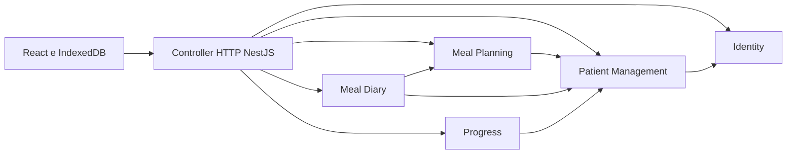
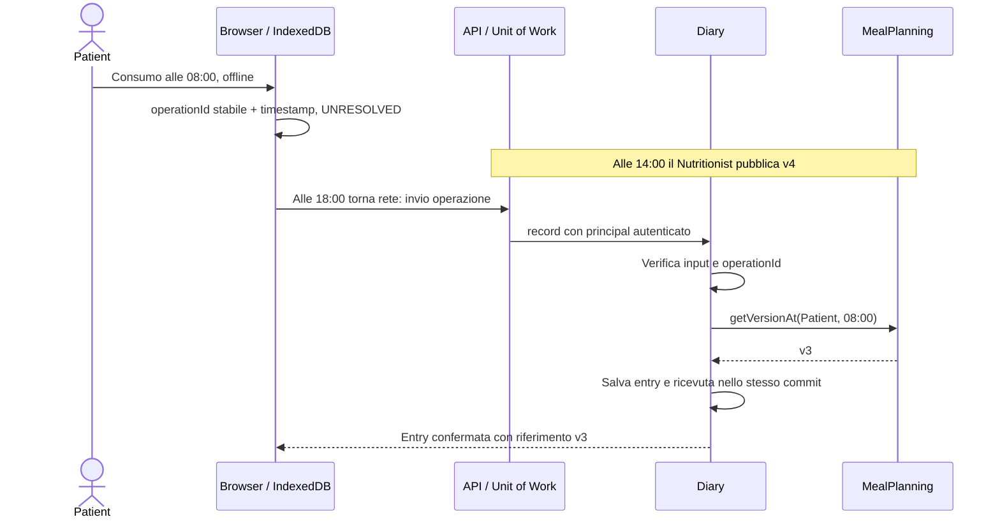

# Guida all'esposizione di NutriTrack
Contratti HTTP con esempi di payload: [API](API.md). Provenienza del database e licenze: [infrastruttura](INFRASTRUCTURE_AND_COSTS.md).
Questo documento indica cosa spiegare, perché è stato scelto e dove trovare l'evidenza nel progetto. Non occorre leggere tutti i file in sequenza: seguire il percorso qui sotto e usare [TRACEABILITY.md](TRACEABILITY.md) per le domande sui singoli requisiti.

## 1. Aprire con il problema e il perimetro
«NutriTrack gestisce il rapporto tra Patient e Nutritionist. Il professionista prescrive piani che evolvono nel tempo; il Patient registra consumi reali e peso anche quando la connessione manca. La storia non deve cambiare quando arriva una nuova prescrizione e il Patient controlla la condivisione del proprio diario.»

Mostrare [requirements.md](requirements.md) e [use-cases.md](use-cases.md). Precisare i due attori e le esclusioni. Il versioning non è uno use case autonomo: il Nutritionist vuole modificare il piano; la nuova versione è il comportamento obbligatorio di UC-09. Il diario è opzionalmente condiviso; il peso resta consultabile dal professionista assegnato.

## 2. Architettura: modular monolith
Un backend deployabile con cinque moduli di business. La modularità riguarda responsabilità e proprietà dei dati, non il numero di processi. UI, HTTP, persistenza e offline sono meccanismi di accesso o infrastruttura; non diventano ulteriori domini nutrizionali.

Le frecce tra moduli significano uso del contratto pubblico, non accesso al database del destinatario. Il controller è il bordo di trasporto e la composition root collega i servizi: non bisogna confondere le sue importazioni con dipendenze di dominio.

| Modulo e codice | Responsabilità | Dati posseduti |
|---|---|---|
| [Identity](../apps/api/src/modules/identity/public/index.ts) | Identità, password, sessioni | Utenti e sessioni |
| [Patient Management](../apps/api/src/modules/patient-management/public/index.ts) | Associazione e accesso del professionista | Inviti e associazioni |
| [Meal Planning](../apps/api/src/modules/meal-planning/public/index.ts) | Prescrizione e storico versioni | Piano, versioni, pasti/opzioni/alimenti, ChangeSet |
| [Meal Diary](../apps/api/src/modules/diary/public/index.ts) | Consumi reali e condivisione | Entry, preferenza e deduplicazione |
| [Progress](../apps/api/src/modules/progress/public/index.ts) | Storico del peso | Measurements e deduplicazione |

Contesto e alternative: ADR-001, 010, 011, 012, 015 e [architecture.md](architecture.md). Microservizi avrebbero aggiunto rete e transazioni distribuite senza un requisito che li richiedesse.

## 3. Pattern realmente utilizzati
| Concetto | Dove leggerlo | Spiegazione da dare |
|---|---|---|
| Facade / public module contract | public/index.ts dei cinque moduli | Il chiamante usa operazioni semantiche, senza conoscere la persistenza. |
| Repository | [shared/contracts.ts](../apps/api/src/shared/contracts.ts), [persistence.ts](../apps/api/src/infrastructure/persistence.ts) | L'application dipende dall'interfaccia; l'adapter Prisma la realizza e i test sostituiscono lo storage. |
| Dependency inversion e injection | [composition/application.ts](../apps/api/src/composition/application.ts) | La composition root fornisce repository, clock e altri contratti ai servizi; il dominio non crea client Prisma. |
| Unit of Work | [shared/unit-of-work.ts](../apps/api/src/shared/unit-of-work.ts), infrastruttura persistente | Una richiesta completa è atomica. Nessuna metà della pubblicazione sopravvive a un fallimento. |
| Domain Service / funzione pura | [resolve-version-at.ts](../apps/api/src/modules/meal-planning/domain/resolve-version-at.ts), [publish-new-version.ts](../apps/api/src/modules/meal-planning/domain/publish-new-version.ts) | Regole temporali senza UI, rete o lettura diretta dell'orologio; verificabili con input deterministici. |
| Optimistic concurrency | publishNewVersion e pubblicazione applicativa | Il client dichiara baseVersionId; base obsoleta produce conflitto, mai merge silenzioso. |
| Idempotent command | record dei moduli Diary e Progress | Stesso operationId/payload ha un solo effetto anche quando si perde la risposta. |
| Adapter HTTP | [app.controller.ts](../apps/api/src/composition/app.controller.ts) | Traduce richieste, principal e codici di errore; non sostituisce le regole server con controlli UI. |
| Local queue / cache | [apps/web/src](../apps/web/src) | La UI conserva operazioni supportate e le riconcilia; non determina la versione confermata. |

Non chiamare «Singleton», «CQRS», «event sourcing» o «microservizi» ciò che non è stato adottato. Versioni immutabili non equivalgono a event sourcing: conserviamo versioni materializzate, non ricostruiamo tutto lo stato da un log di eventi.

## 4. Modello e invarianti temporali
MealPlan è l'identità stabile; MealPlanVersion contiene la prescrizione valida in un intervallo e il collegamento parent. Pasto → alternative → alimenti/quantità/unità descrivono il contenuto. ChangeSet spiega differenze tra contenuti delle versioni. DiaryEntry contiene il consumo reale e un ID esterno opzionale; Measurement rappresenta un valore storico, non il campo corrente di Patient.

Sia valid(v,t) = v.validFrom ≤ t ∧ (v.validUntil = null ∨ t < v.validUntil).

`∀ patient, t: |{v : v.patientId = patient ∧ valid(v,t)}| ≤ 1`

L'intervallo è semiaperto [from, until): la fine non è inclusa. V3 termina alle 14:00 e v4 inizia alle 14:00: il consumo esattamente alle 14:00 usa v4. La chiusura controllata di validUntil non viola l'immutabilità dei contenuti alimentari. Confrontare [test del resolver](../apps/api/tests/resolve-version-at.spec.ts) e [test di pubblicazione](../apps/api/tests/publish-new-version.spec.ts).

Date/ore HTTP hanno offset esplicito e vengono convertite in istanti UTC. consumptionTime, createdAt e tempo di sincronizzazione non sono sinonimi. Il server assegna l'attivazione dei piani; non si pianificano né retrodatano nuove versioni nella prima release.
Se due pubblicazioni cadono nello stesso millisecondo, la seconda può ricevere PublicationBusy: si ritenta dopo avanzamento del clock. Non si crea un intervallo vuoto né si sposta validFrom nel futuro per far passare il test.

## 5. Scenario centrale: offline e versioning

Domanda prevedibile: «E se il server salva, ma la risposta si perde?» La UI ritenta lo stesso operationId. Se payload e proprietario sono uguali il server restituisce l'esito già confermato; non crea un'altra entry. Se il payload cambia, segnala conflitto. Un timestamp locale non confermato non diventa automaticamente un ID versione affidabile.

## 6. Privacy e autorizzazione
Authentication risponde «chi sei?»; authorization risponde «puoi fare questa operazione su questo Patient?». Il ruolo Nutritionist non autorizza a leggere tutti i pazienti.

Per il diario del professionista:

`assigned(nutritionist, patient) ∧ sharingEnabled(patient, currentAssociation)`

La preferenza parte false e si riferisce al diario intero, incluso lo storico; nessun flag shared su ogni entry. Revoca non cancella dati. La visibilità del peso richiede associazione, ma non il consenso al diario. Nuova associazione non eredita una scelta di condivisione fatta per una persona diversa.

Il diniego è un errore distinto da una lista vuota: DiaryNotShared non significa «il Patient non ha mangiato». Il browser Nutritionist non mantiene una cache offline dei diari dei pazienti. Password e session ID non si salvano in IndexedDB. [ADR-005/019/022/026/027](DECISION_SUMMARY.md).

## 7. Persistenza e concorrenza: spiegare il compromesso
Mostrare [schema Prisma](../apps/api/prisma/schema.prisma), repository e Unit of Work. Le tabelle di stato sono separate per modulo. PostgreSQL conserva JSON degli aggregati; l'ownership è imposta dalla composizione e dalle interfacce, non da un accesso indiscriminato di tutti i servizi allo stesso oggetto.

La transazione con advisory lock comune serializza pubblicazione, autorizzazione e deduplicazione. È una scelta prudente per il progetto accademico, con throughput limitato e salvataggi ampi. Protegge tutte le operazioni che passano dall'applicazione; non si afferma che una scrittura SQL manuale esterna sia automaticamente valida. In un'evoluzione si potrebbero normalizzare tabelle, aggiungere vincoli specifici e ridurre la granularità dei lock senza cambiare il contratto di dominio.

## 8. API contro eventi
Diary ha bisogno di una risposta immediata da getVersionAt; i servizi di lettura hanno bisogno di isAssigned. Qui la chiamata interna sincrona è appropriata. Un evento come MealPlanVersionCreated comunicherebbe un fatto a eventuali consumer non critici, ma non è necessario introdurre un event bus senza un consumer richiesto.

ADR-013 definisce quando scegliere i due meccanismi; NFR-04 richiede comunicazione esplicita tramite API **o** eventi. Usare API è sufficiente. La ricostruzione storica e i controlli privacy non dipendono da eventi consegnati in ritardo.

## 9. Dimostrazione consigliata
1. Avviare seguendo [RUNBOOK.md](RUNBOOK.md), mostrare esito dei test realmente eseguiti.
2. Entrare come Nutritionist e mostrare pazienti associati; creare v1 con un pasto, un'alternativa e un alimento.
3. Entrare come Patient, consultare il piano e registrare un consumo. Mostrare il riferimento versione della entry.
4. Nutritionist tenta di leggere il diario: diniego perché privato; il Patient abilita la condivisione e la lettura diventa possibile.
5. Il Patient registra il peso; Nutritionist lo consulta indipendentemente dalla preferenza diario.
6. Pubblicare v2 e mostrare storico/ChangeSet. Test o due finestre dimostrano base obsoleta → conflitto.
7. Preparare shell e dati online, disconnettere il browser tramite DevTools, registrare un pasto e osservare pending. Ripristinare rete e osservare conferma senza duplicati.
8. Usare un Patient non assegnato per mostrare il limite di accesso e il flusso invito/accettazione.

Non cambiare l'orologio del sistema per simulare il passato: i test iniettano il clock e rappresentano gli scenari in modo ripetibile. Nella demo browser si può selezionare un consumo avvenuto prima della nuova versione.

## 10. Domande e risposte da preparare
| Domanda | Risposta supportata dal progetto |
|---|---|
| Perché non un database per modulo? | Ownership logica è sufficiente nel monolite; repository e contratti separano i dati. |
| Perché MealPlanVersion immutabile? | Il diario storico deve continuare a indicare la prescrizione valida allora. |
| Perché null come riferimento? | È ammesso registrare il consumo senza piano applicabile. Pending non è null confermato. |
| Perché server-side authorization? | Il client è modificabile; solo principal e dati server provano diritti correnti. |
| Come evitate il doppio invio offline? | OperationId stabile e ricevuta salvata atomicamente con l'effetto. |
| Come provate isolamento/testabilità? | Fake repository e test senza UI, più test infrastrutturali separati. |
| Cosa non è stato fatto? | Esclusioni di scope dichiarate e limiti di verifica nel runbook; non aggiungiamo feature per impressionare. |

## 11. Mappa rapida delle spiegazioni
Concetti studiabili: [notebook](PROJECT_DESIGN_NOTEBOOK.md). Tutte le scelte: [riepilogo](DECISION_SUMMARY.md) e [ADR](adr/README.md). Catalogo requisiti: [requirements](requirements.md). Comportamenti: [use cases](use-cases.md). Collegamenti requisito→codice→prova: [tracciabilità](TRACEABILITY.md). Avvio e demo: [runbook](RUNBOOK.md). Le guide [fase 0](increments/phase-00.md), [fase 1](increments/phase-01.md) e [fase 2](increments/phase-02.md) spiegano i primi file riga per riga e sono conservate come percorso didattico.
